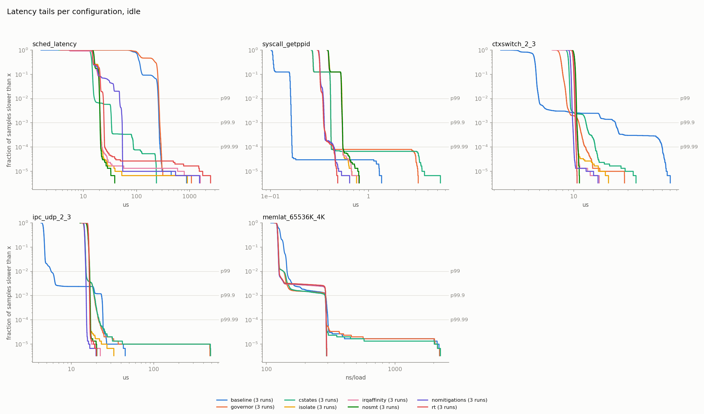
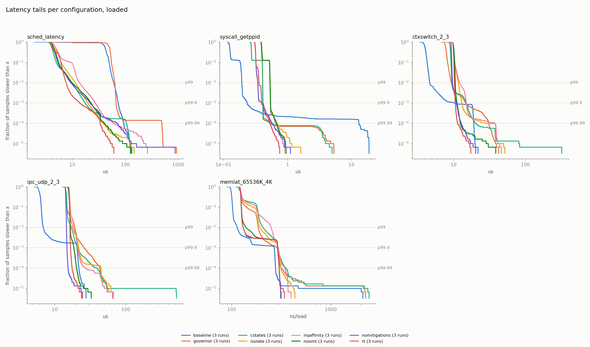

# Linux Latency Characterization Suite

Where does latency come from on a Linux machine, and what does each tuning knob actually buy?
This repo is a measurement harness written in C, an unattended campaign that reboots through
**8 cumulative kernel configurations × 3 runs × idle/loaded**, and an offline analysis that
reports percentiles to p99.99, separates throttled from unthrottled samples, and calls a
difference **inconclusive** when it is smaller than the variance between reboots.

It runs on a dedicated ThinkPad T490 (i5-8365U, 4C/8T), with stock and PREEMPT_RT
Debian 6.12.115 kernels.

> **Laptop numbers are not server numbers.** The absolute values below belong to one
> thermally limited laptop with firmware interrupts that can't be turned off. The result is
> the **delta between configurations on the same hardware**, plus a named and measured
> platform floor.

**Headline findings:**
- **The platform floor is firmware.** A System Management Interrupt takes the CPU away for
  **2.1 ms**, about 6 times per 20 minutes under load. No kernel setting can prevent it, so it sets the
  worst case for every configuration, PREEMPT_RT included.
- **`mitigations=off` halves the null-syscall tail.** Added to an untuned baseline, it cuts
  `getppid()` by 29% at p50 and 50% at p99.9, idle and loaded alike. This CPU has no KPTI,
  so the cost is Enhanced IBRS, the BHI loop and VERW buffer clearing.
- **Limiting C-states is the biggest single wakeup-latency knob**: about −90% on idle
  timer-wakeup latency at p50 and p99.9.
- **Turning turbo off makes every CPU-bound path 1.7–3.1x slower at p50** (syscalls,
  context switches, IPC, cache hits; 1.6 GHz instead of up to 4.1 GHz). DRAM latency barely
  changes. What it buys is determinism: every turbo ratio change stalls the whole package for ~14 µs,
  and with turbo off the loaded package peaks at 57 °C instead of 100 °C and never throttles.
- **PREEMPT_RT trims the loaded wakeup tail, not the median.** On top of every other knob it
  cuts loaded timer-wakeup p99.9 from 21.6 to 13.8 µs (−36%). p50 and every idle percentile
  stay within run-to-run spread. The price: pipe throughput halves and cheap syscalls run 8% slower.
- **Only 237 of 702 measured knob effects exceed reboot-to-reboot spread.** Most "results"
  a single run would have shown are noise.

## The matrix

Each row adds one knob to the previous row, so each step measures that knob's marginal
contribution (`configs/matrix.json`):

| # | Config | Adds | Kernel |
|---|---|---|---|
| 0 | `baseline` | Debian defaults: `powersave`, turbo on, all C-states | stock |
| 1 | `governor` | `performance` governor, turbo off | stock |
| 2 | `cstates` | `intel_idle.max_cstate=0 processor.max_cstate=1` | stock |
| 3 | `isolate` | `isolcpus` / `nohz_full` / `rcu_nocbs` = 2,3,6,7 | stock |
| 4 | `irqaffinity` | `irqaffinity=0,1,4,5` | stock |
| 5 | `nosmt` | `nosmt` | stock |
| 6 | `nomitigations` | `mitigations=off` | stock |
| 7 | `rt` | all of the above on PREEMPT_RT | RT |
| spot | `spot-nomitigations` | baseline + `mitigations=off` only | stock |

The isolated set is whole physical cores. Measurement runs on CPUs 2 and 3, while load and
housekeeping run on 0, 1, 4 and 5:

```
 core:      0        1        2        3
 threads: [0 | 4]  [1 | 5]  [2 | 6]  [3 | 7]
          \_______________/  \_______________/
          housekeeping, IRQs   isolated (isolcpus, nohz_full, rcu_nocbs)
          stress-ng load       harness pinned to 2 (and 3 for cross-core)
```

Isolating only CPUs 2 and 3, as many guides do, would leave load running on their SMT siblings
6 and 7, and the benefit of isolation would wrongly be credited to `nosmt`.

### What is measured

| Class | Binary | How |
|---|---|---|
| Timer wakeup | `sched_latency` | `clock_nanosleep(TIMER_ABSTIME)` on absolute deadlines; actual − intended wake |
| Syscall | `syscall_bench` | `getppid()` (real kernel entry), `clock_gettime` MONOTONIC and MONOTONIC_RAW (vDSO), and an empty loop (the timer's own cost) |
| Context switch | `ctxswitch` | pipe ping-pong on the same CPU, SMT siblings, and across cores |
| Memory | `memlat` | random pointer chase from L1 to DRAM, 4 KiB vs 2 MiB pages |
| IPC | `ipc_latency` | `eventfd` wakeup and loopback UDP round trip, cross-core |
| Platform floor | `hwgap` | spins on a CPU and records every gap over 300 ns, with the SMI counter (MSR 0x34) read per gap |

Every binary uses `mlockall`, verified CPU pinning, `SCHED_FIFO`, pre-faulted buffers, a
time-based warmup (≥200 ms) and ≥100,000 measured samples. Raw samples are written to binary
files, and no statistics are computed in the measurement loop. Each run also writes a JSON
sidecar with the kernel, cmdline, taint, governor, turbo, platform profile, cTDP level,
APERF/MPERF, SMI count and PM QoS target, plus a 100 ms monitor log of temperature, throttle
counters and cTDP level. BIOS settings were recorded once (`docs/platform.md`) and not changed
during the campaign. Full method: [`docs/methodology.md`](docs/methodology.md).

## Per-knob marginal contribution


Each cell is one knob's step: the median of 3 runs against the median of the previous config's
3 runs. Blue is faster and red is slower. **Grey cells failed the variance test**: the
change was smaller than the spread between that config's own reboots, so they are reported as
"not shown to differ" rather than as a number.


## Results matrix

<!-- matrix:begin -->
**idle** (p50 / p99 / p99.9)

| config | runs | timer wakeup (µs) | getppid() (ns) | ctx switch, cross-core (µs) | UDP loopback RTT (µs) | DRAM load, 4K pages (ns) |
|---|---:|---:|---:|---:|---:|---:|
| `baseline` | 3 | 106 / 244 / 258 | 106 / 161 / 163 | 4.53 / 4.95 / 23 | 4.62 / 5.74 / 23.3 | 126 / 139 / 288 |
| `governor` | 3 | 130 / 264 / 275 | 270 / 409 / 413 | 7.66 / 8.52 / 11.1 | 14.3 / 15 / 18.9 | 122 / 136 / 286 |
| `cstates` | 3 | 14.1 / 15.9 / 23.9 | 271 / 409 / 412 | 8.93 / 9.28 / 12.8 | 14.5 / 15.1 / 19 | 122 / 136 / 286 |
| `isolate` | 3 | 15.9 / 20.2 / 21.1 | 394 / 533 / 541 | 10 / 10.5 / 10.7 | 16 / 16.6 / 16.8 | 122 / 126 / 289 |
| `irqaffinity` | 3 | 16.2 / 19.4 / 20.5 | 389 / 528 / 538 | 9.96 / 10.4 / 10.5 | 16 / 16.6 / 16.8 | 122 / 125 / 289 |
| `nosmt` | 3 | 15.9 / 20.2 / 20.6 | 391 / 528 / 536 | 10.1 / 10.4 / 10.6 | 15.6 / 16.3 / 16.6 | 122 / 126 / 289 |
| `nomitigations` | 3 | 15 / 22 / 22.9 | 317 / 346 / 353 | 9.32 / 9.59 / 9.75 | 14.4 / 14.9 / 15.1 | 122 / 125 / 289 |
| `rt` | 3 | 14.9 / 21.2 / 21.6 | 313 / 341 / 346 | 9.87 / 10.2 / 10.3 | 15.9 / 16.4 / 16.5 | 122 / 126 / 289 |
| *`spot-nomitigations`* | 3 | 108 / 244 / 258 | 75 / 78 / 81 | 4.15 / 4.82 / 22.7 | 4.22 / 5.23 / 22.8 | 126 / 139 / 288 |

**loaded** (p50 / p99 / p99.9)

| config | runs | timer wakeup (µs) | getppid() (ns) | ctx switch, cross-core (µs) | UDP loopback RTT (µs) | DRAM load, 4K pages (ns) |
|---|---:|---:|---:|---:|---:|---:|
| `baseline` | 3 | 41.6 / 60.2 / 72.5 | 125 / 193 / 233 | 4.01 / 4.66 / 8.47 | 6.05 / 6.89 / 20.7 | 99.5 / 114 / 174 |
| `governor` | 3 | 50.7 / 63.2 / 66.8 | 270 / 409 / 413 | 7.75 / 9.18 / 15.4 | 14.4 / 18.1 / 26.9 | 124 / 185 / 282 |
| `cstates` | 3 | 3.98 / 9.67 / 16.5 | 271 / 407 / 410 | 8.98 / 9.47 / 15 | 14.6 / 16.4 / 21.2 | 123 / 213 / 292 |
| `isolate` | 3 | 4.6 / 11.1 / 19.6 | 390 / 529 / 537 | 9.96 / 11.7 / 13.1 | 16 / 19.7 / 22.2 | 124 / 193 / 290 |
| `irqaffinity` | 3 | 4.65 / 12.5 / 21.7 | 390 / 530 / 539 | 10 / 11.6 / 12.9 | 16 / 18.3 / 20 | 125 / 164 / 294 |
| `nosmt` | 3 | 4.42 / 9.87 / 22.5 | 396 / 533 / 541 | 10.1 / 10.6 / 11.2 | 15.8 / 16.6 / 18.2 | 123 / 133 / 293 |
| `nomitigations` | 3 | 4.16 / 9.03 / 21.6 | 312 / 339 / 358 | 9.26 / 9.73 / 11 | 14.3 / 14.7 / 14.9 | 123 / 131 / 291 |
| `rt` | 3 | 4.14 / 7.37 / 13.8 | 311 / 343 / 393 | 9.92 / 10.3 / 10.6 | 16 / 16.4 / 16.6 | 123 / 131 / 292 |
| *`spot-nomitigations`* | 3 | 36.4 / 57.5 / 73.8 | 89 / 100 / 117 | 3.63 / 4.26 / 8.66 | 5.53 / 6.25 / 19.9 | 99.5 / 114 / 168 |

Median of each config's runs; the spot row (italic) is baseline + one knob, not cumulative. Generated by `analysis/table.py` from `results/summary.csv`.
<!-- matrix:end -->

## Latency tails, every class

The matrix shows three percentiles. These show the whole tail: each line is one config's
3 runs pooled, read as "the fraction of samples slower than x", so p99, p99.9 and p99.99 sit at
1e-2, 1e-3 and 1e-4. Pooling shows the tail's shape; whether two configs differ is the
variance test's job above.





## PREEMPT_RT: what it buys and what it costs

Rows 6 and 7 have the same cmdline; only the kernel differs. On loaded timer wakeups, RT cuts
p99.9 from 21.6 to 13.8 µs (−36%) and p99 from 9.0 to 7.4 µs (−18%), with p50 unchanged. Idle,
every difference is within run-to-run spread.

Its cost, measured as `stress-ng` throughput (2 workers on housekeeping CPUs 0–1, 60 s per
stressor, 3 boots per kernel, no throttle events, package ≤45 °C):

| stressor | what it exercises | `nomitigations` ops/s | `rt` ops/s | change | run-to-run spread |
|---|---|---|---|---|---|
| `pipe` | pipe write/read between two tasks | 950k | 441k | **−54%** | 3.0% |
| `get` | `get*()` syscalls (getpid, getuid, …) | 1.46M | 1.34M | **−8.5%** | 1.6% |
| `cpu` | pure computation | 1423 | 1408 | −1.1% (inconclusive) | 3.0% |
| `switch` | context switches via message passing | 455k | 452k | −0.6% (inconclusive) | 2.3% |
| `vm` | anonymous memory writes | 24.57k | 24.56k | −0.05% | 0.05% |

Computation and memory traffic cost nothing, cheap syscalls cost ~8%, and pipe I/O runs at
half speed. Pipe workers spend the same CPU time on both kernels, almost all of it in the kernel,
but RT completes half as many operations. RT turning kernel spinlocks into sleeping, priority-
inheriting locks is the likely reason, though it was not profiled. Generated by
`analysis/throughput.py` from `results/throughput/`.

## The platform floor

Measured with `hwgap` on an isolated CPU, with sources identified by tracing
(`docs/platform.md`):

| What takes the CPU away | Duration | Rate | Can the OS remove it? |
|---|---|---|---|
| Local timer interrupt (250 Hz tick, hrtimers) | ~1 µs | 255/s | yes: `nohz_full` |
| Softirqs at interrupt exit (sched, timer, RCU) | 5–100 µs | 34/s idle, **165/s with load on other CPUs** | mostly: isolation |
| Turbo ratio change (stalls the whole package) | ~14 µs | 15–710/s | yes: turbo off |
| e1000e watchdog polling an **unplugged** Ethernet PHY | ~0.5 ms | every 2 s | yes: isolation, or don't load it |
| **SMI** (firmware) | **2.1 ms** | 0–1 per 20 min idle, 6 per 20 min loaded | **no** |


Thermal: with turbo on (`baseline` and the spot row), sustained load holds the package at
~96 °C, peaking at 100 °C, and ~98% of loaded samples fall in a throttled 100 ms interval. It
reaches its temperature limit before its 25 W power limit. With turbo off (rows 1–7), loaded
runs peak at 51–57 °C and no sample is throttled, so every step from row 1 on compares
unthrottled data. Only the `baseline → governor` step crosses from throttled to unthrottled,
which is part of what that step measures. Every result is split into throttled and unthrottled
samples (`analysis/analyze.py`, `thr_frac` in `results/summary.csv`).

## Validation

The harness was checked against reference tools before any campaign data was trusted
(`docs/validation.md`):

- `sched_latency` agrees with `cyclictest` **within ±1 µs from p50 to p99.9** once both hold
  `/dev/cpu_dma_latency` at the same value. Without that, the two tools disagree for reasons
  unrelated to either harness.
- `memlat` plateaus agree with `perf stat` cache and dTLB miss counters.
- `hwgap` matched 5/5 SMIs against the kernel's hwlat tracer, and its extra ~23 µs stalls were
  traced to turbo transitions.
- Instrumentation overhead (one timestamp pair) is **14 ns at 4.1 GHz and 36 ns at 1.6 GHz**.
  It is measured in every run and reported alongside every syscall number.


## How the campaign runs

One boot = one (config, round). A systemd unit drives the whole matrix unattended:

```
boot ─► latency-collect.service ─► collect.sh run
          │ verify kernel + cmdline match the queued row (2 failed boots → skip, logged)
          │ apply runtime setup: governor, turbo, platform_profile, cTDP check
          │ settle 3 min (abort window: touch ~/STOP-CAMPAIGN)
          │ Wi-Fi off ─► run-suite.sh idle ─► run-suite.sh loaded ─► Wi-Fi on
          │ clock guard: a run measured at the wrong clock is failed and retried
          │ set-config.sh <next row> (grub-reboot one-shot for RT)
          └─► reboot
```

Rounds go round-robin (every config once, then every config again), so slow drift such as room
temperature or firmware state is spread across configurations rather than landing on one.
A failed or skipped test is recorded as `FAILED` in `run.json`, never left silently missing.

## Limitations

- **One laptop.** Absolute numbers are this T490's. They show what each knob does here, not
  what it does on a server.
- **SMIs can't be disabled** and the trigger of the loaded-state SMIs is unidentified. Any
  p99.99 or max that includes one measures the firmware, not the kernel.
- **Turbo was not held under `nosmt` at first.** `intel_pstate`'s `no_turbo` only caps
  online threads, and siblings parked by `nosmt` kept requesting turbo, so rows 5–7 first ran
  at 3.3 GHz. An apparent "nosmt makes syscalls faster" result was entirely clock. Those runs
  were superseded (`results/superseded-turbo/`) and rerun with turbo disabled through
  MSR 0x1A0 bit 38 on every CPU.
- **Firmware changed the clock under the OS.** In 4 of 40 boots the firmware switched the package to
  cTDP level 1 (800 MHz, 10 W) for ~3 minutes while sysfs still reported `performance`.
  Every clock-bound test in that window was exactly 2.0x slower. The harness now logs the
  cTDP MSR (0x64B) and fails such runs. The cause of the switch is unknown.
  The affected runs were set aside (`results/superseded-ctdp/`) and rerun. One rerun hit a
  fourth episode, which the guard caught and retried on the next boot. Runs from before the
  cTDP logging were checked instead by each test's p50 against its config's median: none is
  above 1.4x, against the 2.0x signature.
- **`scaling_cur_freq` is wrong on `nohz_full` CPUs** (it reads 400 MHz), so the clock is taken
  from APERF/MPERF instead.
- **3 runs per config.** The variance test is the plain max−min range of 3 runs, which is
  conservative: one odd boot makes a step inconclusive.
- **Turbo-on loaded runs are almost all throttled** (`baseline`, spot row), so those two rows
  have little unthrottled data. The `baseline → governor` step mixes the clock change with the
  end of throttling and is not split into the two.
- **Unexplained: `getppid()` gets ~45% slower at p50 when `isolate` is added** (271 → 394 ns
  idle). `nohz_full` context tracking on syscall entry/exit is the suspect; it was not verified.
- **PREEMPT_RT is Debian's packaged `-rt` kernel**, not built from kernel.org plus the RT patch.
  Its throughput cost was measured on 5 `stress-ng` stressors only, not on a real workload.

## Build and run from clean

On the target machine (Debian 13, root via sudo):

```sh
# T490: ~
sudo apt install build-essential rt-tests stress-ng linux-perf msr-tools linux-cpupower \
                 python3-numpy python3-pandas python3-matplotlib git
git clone https://github.com/RodeanAzari/linux-latency-suite.git && cd linux-latency-suite
make -C harness                          # -> harness/build/*
sudo modprobe msr

# one measurement, by hand: CPU 2, monitor on CPU 0
mkdir -p /tmp/out && sudo harness/build/sched_latency -c 2 -m 0 -o /tmp/out
python3 analysis/analyze.py /tmp/out/sched_latency.bin

# the full campaign: queue all configs x 3 rounds, install the unit, reboot
scripts/collect.sh init 3
scripts/collect.sh status                # after it finishes

# analysis (tests: python3 -m pytest, from the repo root; needs pytest)
python3 analysis/summarize.py            # -> results/summary.csv
python3 analysis/deltas.py               # -> results/deltas.csv
python3 analysis/plot_knobs.py           # -> docs/imgs/knob_deltas_p99.9.png
python3 analysis/plot_variance.py        # -> docs/imgs/variance_vs_effect.png
T="sched_latency syscall_getppid ctxswitch_2_3 ipc_udp_2_3 memlat_65536K_4K"
python3 analysis/plot_tails.py results idle docs/imgs/tails_idle.png $T     # raw .bin needed
python3 analysis/plot_tails.py results loaded docs/imgs/tails_loaded.png $T

# PREEMPT_RT throughput cost: nomitigations vs rt, 3 boots each
SUITE=throughput scripts/collect.sh init 3 6 7
python3 analysis/throughput.py           # -> results/throughput.csv
```

Machine setup (BIOS state, disabled services, GRUB layout, held kernels) is in
`docs/platform.md`, the method in `docs/methodology.md`, and the original spec in
`docs/buildplan.md`.

## Repository layout

```
harness/    one C binary per measurement class + hwgap; shared code in common.c/.h
scripts/    set-config.sh, run-suite.sh, collect.sh + systemd unit; one-off experiments
configs/    matrix.json, the configuration table as data
analysis/   summarize.py, deltas.py, throughput.py, clock_guard.py, plot_*.py, gaps.py, match_*.py,
            test_*.py (pytest)
results/    summary.csv, deltas.csv, throughput.csv, a representative subset of raw samples
docs/       methodology.md, platform.md, validation.md, buildplan.md (spec), imgs/
```
