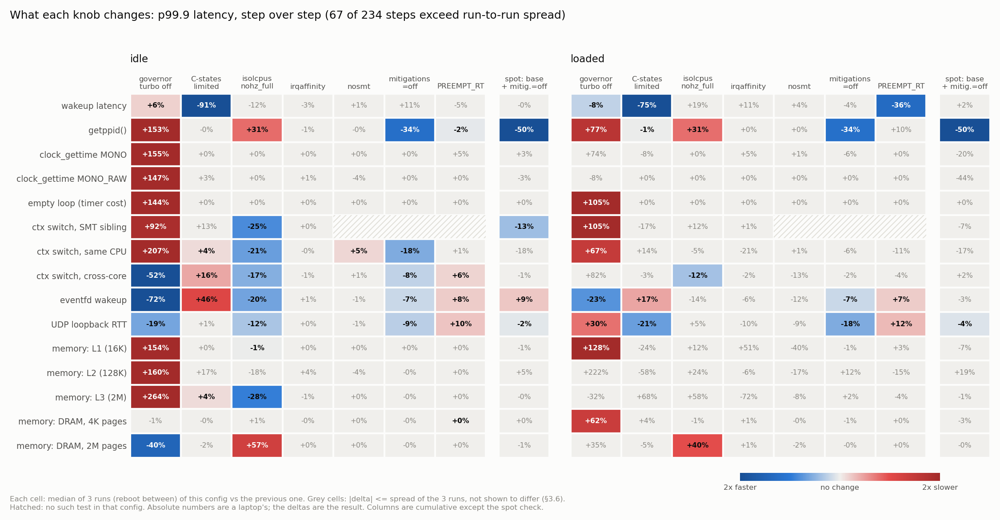
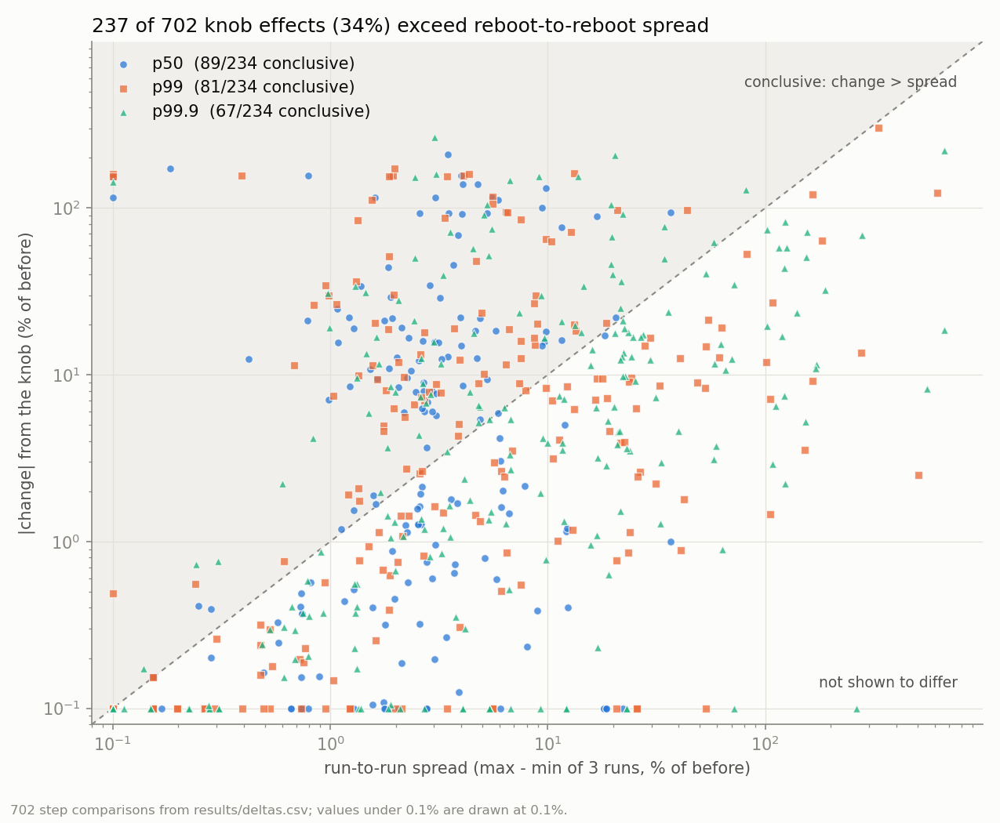
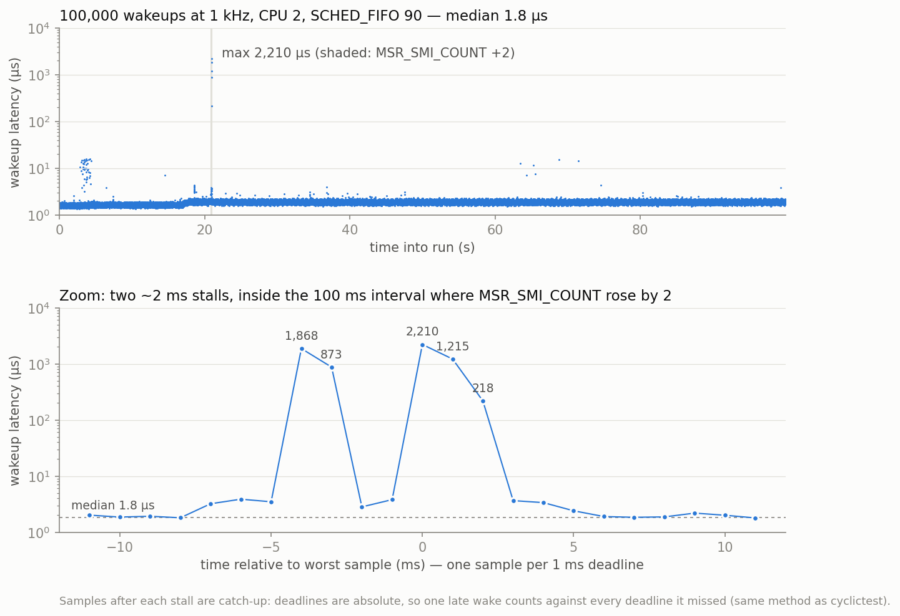
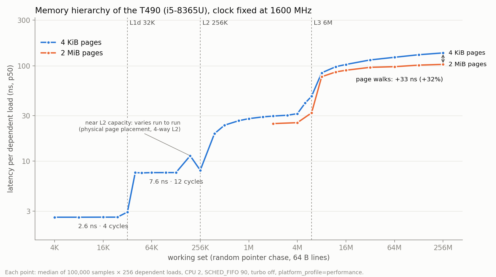

# Linux Latency Characterization Suite

Where does latency come from on a Linux machine, and what does each tuning knob actually buy?
This repo is a measurement harness written in C, an unattended campaign that reboots through
**8 cumulative kernel configurations × 3 runs × idle/loaded**, and an offline analysis that
reports percentiles to p99.99, separates throttled from unthrottled samples, and calls a
difference **inconclusive** when it is smaller than the variance between reboots.

It runs on a dedicated ThinkPad T490 (i5-8365U, 4C/8T), with stock and PREEMPT_RT
Debian 6.12.115 kernels.

> **Laptop numbers are not server numbers.** The absolute values below belong to one
> thermally limited laptop with firmware interrupts that can't be turned off. The result is
> the **delta between configurations on the same hardware**, plus a named and measured
> platform floor.

<!-- TODO(after cTDP rerun): replace with the final headline paragraph. -->
**Headline findings** *(provisional: three runs are being repeated, see Limitations)*:
- **The platform floor is firmware.** A System Management Interrupt takes the CPU away for
  **2.1 ms**, about 6 times per 20 minutes under load. No kernel setting can prevent it, so it sets the
  worst case for every configuration, PREEMPT_RT included.
- **`mitigations=off` halves the null-syscall tail.** Added to an untuned baseline, it cuts
  `getppid()` by 29% at p50 and 50% at p99.9, idle and loaded alike. This CPU has no KPTI,
  so the cost is Enhanced IBRS, the BHI loop and VERW buffer clearing.
- **Limiting C-states is the biggest single wakeup-latency knob**: about −90% on idle
  timer-wakeup latency at p50 and p99.9.
- **Turning turbo off makes every CPU-bound path 1.7–3.1x slower at p50** (syscalls,
  context switches, IPC, cache hits; 1.6 GHz instead of up to 4.1 GHz). DRAM latency barely
  changes. What it buys is determinism: every turbo ratio change stalls the whole package for ~14 µs.
- **Only 154 of 702 measured knob effects exceed reboot-to-reboot spread.** Most "results"
  a single run would have shown are noise.

## The matrix

Each row adds one knob to the previous row, so each step measures that knob's marginal
contribution (`configs/matrix.json`):

| # | Config | Adds | Kernel |
|---|---|---|---|
| 0 | `baseline` | Debian defaults: `powersave`, turbo on, all C-states | stock |
| 1 | `governor` | `performance` governor, turbo off | stock |
| 2 | `cstates` | `intel_idle.max_cstate=0 processor.max_cstate=1` | stock |
| 3 | `isolate` | `isolcpus` / `nohz_full` / `rcu_nocbs` = 2,3,6,7 | stock |
| 4 | `irqaffinity` | `irqaffinity=0,1,4,5` | stock |
| 5 | `nosmt` | `nosmt` | stock |
| 6 | `nomitigations` | `mitigations=off` | stock |
| 7 | `rt` | all of the above on PREEMPT_RT | RT |
| spot | `spot-nomitigations` | baseline + `mitigations=off` only | stock |

The isolated set is whole physical cores. Measurement runs on CPUs 2 and 3, while load and
housekeeping run on 0, 1, 4 and 5:

```
 core:      0        1        2        3
 threads: [0 | 4]  [0 | 5]  [2 | 6]  [3 | 7]
          \_______________/  \_______________/
          housekeeping, IRQs   isolated (isolcpus, nohz_full, rcu_nocbs)
          stress-ng load       harness pinned to 2 (and 3 for cross-core)
```

Isolating only CPUs 2 and 3, as many guides do, would leave load running on their SMT siblings
6 and 7, and the benefit of isolation would wrongly be credited to `nosmt`.

### What is measured

| Class | Binary | How |
|---|---|---|
| Timer wakeup | `sched_latency` | `clock_nanosleep(TIMER_ABSTIME)` on absolute deadlines; actual − intended wake |
| Syscall | `syscall_bench` | `getppid()` (real kernel entry), `clock_gettime` MONOTONIC and MONOTONIC_RAW (vDSO), and an empty loop (the timer's own cost) |
| Context switch | `ctxswitch` | pipe ping-pong on the same CPU, SMT siblings, and across cores |
| Memory | `memlat` | random pointer chase from L1 to DRAM, 4 KiB vs 2 MiB pages |
| IPC | `ipc_latency` | `eventfd` wakeup and loopback UDP round trip, cross-core |
| Platform floor | `hwgap` | spins on a CPU and records every gap over 300 ns, with the SMI counter (MSR 0x34) read per gap |

Every binary uses `mlockall`, verified CPU pinning, `SCHED_FIFO`, pre-faulted buffers, a
time-based warmup (≥200 ms) and ≥100,000 measured samples. Raw samples are written to binary
files, and no statistics are computed in the measurement loop. Each run also writes a JSON
sidecar with the kernel, cmdline, BIOS settings, taint, platform profile, cTDP level,
APERF/MPERF and SMI count, plus a 100 ms monitor log of temperature and throttle counters.

## Per-knob marginal contribution

<!-- TODO(after cTDP rerun): python analysis/plot_knobs.py, commit docs/imgs/knob_deltas_p99.9.png -->


Each cell is one knob's step: the median of 3 runs against the median of the previous config's
3 runs. Blue is faster and red is slower. **Grey cells failed the variance test**: the
change was smaller than the spread between that config's own reboots, so they are reported as
"not shown to differ" rather than as a number.



<!-- TODO(after cTDP rerun): results table, p50/p99/p99.9 per class × config, from results/summary.csv. -->

## The platform floor

Measured with `hwgap` on an isolated CPU, with sources identified by tracing
(`docs/platform.md`):

| What takes the CPU away | Duration | Rate | Can the OS remove it? |
|---|---|---|---|
| Local timer interrupt (250 Hz tick, hrtimers) | ~1 µs | 255/s | yes: `nohz_full` |
| Softirqs at interrupt exit (sched, timer, RCU) | 5–100 µs | 34/s idle, **165/s with load on other CPUs** | mostly: isolation |
| Turbo ratio change (stalls the whole package) | ~14 µs | 15–710/s | yes: turbo off |
| e1000e watchdog polling an **unplugged** Ethernet PHY | ~0.5 ms | every 2 s | yes: isolation, or don't load it |
| **SMI** (firmware) | **2.1 ms** | 0–1 per 20 min idle, 6 per 20 min loaded | **no** |



Thermal: under sustained load the package sits at 95–98 °C and throttles almost continuously
(~99% of loaded samples fall in a throttled 100 ms interval). It reaches its temperature limit
before its 25 W power limit. Every result is split into throttled and unthrottled samples;
under load the unthrottled share is too small to report a tail for, which is itself the result.

## Validation

The harness was checked against reference tools before any campaign data was trusted
(`docs/validation.md`):

- `sched_latency` agrees with `cyclictest` **within ±1 µs from p50 to p99.9** once both hold
  `/dev/cpu_dma_latency` at the same value. Without that, the two tools disagree for reasons
  unrelated to either harness.
- `memlat` plateaus agree with `perf stat` cache and dTLB miss counters.
- `hwgap` matched 5/5 SMIs against the kernel's hwlat tracer, and its extra ~23 µs stalls were
  traced to turbo transitions.
- Instrumentation overhead (one timestamp pair) is **14 ns at 4.1 GHz and 36 ns at 1.6 GHz**.
  It is measured in every run and reported alongside every syscall number.



## How the campaign runs

One boot = one (config, round). A systemd unit drives the whole matrix unattended:

```
boot ─► latency-collect.service ─► collect.sh run
          │ verify kernel + cmdline match the queued row (2 failed boots → skip, logged)
          │ apply runtime setup: governor, turbo, platform_profile, cTDP check
          │ settle 3 min (abort window: touch ~/STOP-CAMPAIGN)
          │ Wi-Fi off ─► run-suite.sh idle ─► run-suite.sh loaded ─► Wi-Fi on
          │ clock guard: a run measured at the wrong clock is failed and retried
          │ set-config.sh <next row> (grub-reboot one-shot for RT)
          └─► reboot
```

Rounds go round-robin (every config once, then every config again), so slow drift such as room
temperature or firmware state is spread across configurations rather than landing on one.
A failed or skipped test is recorded as `FAILED` in `run.json`, never left silently missing.

## Limitations

- **One laptop.** Absolute numbers are this T490's. They show what each knob does here, not
  what it does on a server.
- **SMIs can't be disabled** and the trigger of the loaded-state SMIs is unidentified. Any
  p99.99 or max that includes one measures the firmware, not the kernel.
- **Turbo was not held under `nosmt` at first.** `intel_pstate`'s `no_turbo` only caps
  online threads, and siblings parked by `nosmt` kept requesting turbo, so rows 5–7 first ran
  at 3.3 GHz. An apparent "nosmt makes syscalls faster" result was entirely clock. Those runs
  were superseded (`results/superseded-turbo/`) and rerun with turbo disabled through
  MSR 0x1A0 bit 38 on every CPU.
- **Firmware changed the clock under the OS.** In 3 of 36 boots the firmware switched the package to
  cTDP level 1 (800 MHz, 10 W) for ~3 minutes while sysfs still reported `performance`.
  Every clock-bound test in that window was exactly 2.0x slower. The harness now logs the
  cTDP MSR (0x64B) and fails such runs. The cause of the switch is unknown.
  <!-- TODO(after cTDP rerun): state the rerun outcome. -->
- **`scaling_cur_freq` is wrong on `nohz_full` CPUs** (it reads 400 MHz), so the clock is taken
  from APERF/MPERF instead.
- **3 runs per config.** The variance test is the plain max−min range of 3 runs, which is
  conservative: one odd boot makes a step inconclusive.
- **Loaded runs are almost all throttled.** The thermal split is reported, but under load
  there is little unthrottled data to compare against.
- PREEMPT_RT's throughput cost is not yet measured.
  <!-- TODO: Phase F throughput comparison. -->

## Build and run from clean

On the target machine (Debian 13, root via sudo):

```sh
# T490: ~
sudo apt install build-essential rt-tests stress-ng linux-perf msr-tools linux-cpupower \
                 python3-numpy python3-pandas python3-matplotlib git
git clone <this repo> linux-latency-suite && cd linux-latency-suite
make -C harness                          # -> harness/build/*
sudo modprobe msr

# one measurement, by hand: CPU 2, monitor on CPU 0
mkdir -p /tmp/out && sudo harness/build/sched_latency -c 2 -m 0 -o /tmp/out
python3 analysis/analyze.py /tmp/out/sched_latency.bin

# the full campaign: queue all configs x 3 rounds, install the unit, reboot
scripts/collect.sh init 3
scripts/collect.sh status                # after it finishes

# analysis
python3 analysis/summarize.py            # -> results/summary.csv
python3 analysis/deltas.py               # -> results/deltas.csv
python3 analysis/plot_knobs.py           # -> docs/imgs/knob_deltas_p99.9.png
python3 analysis/plot_variance.py        # -> docs/imgs/variance_vs_effect.png
python3 analysis/plot_tails.py results loaded docs/imgs/tails_loaded.png sched_latency syscall_getppid
```

Machine setup (BIOS state, disabled services, GRUB layout, held kernels) is in
`docs/platform.md`. The full spec and methodology are in `docs/buildplan.md` (§3).

## Repository layout

```
harness/    one C binary per measurement class + hwgap; shared code in common.c/.h
scripts/    set-config.sh, run-suite.sh, collect.sh + systemd unit; one-off experiments
configs/    matrix.json, the configuration table as data
analysis/   summarize.py, deltas.py, clock_guard.py, plot_*.py, gaps.py, match_*.py
results/    summary.csv, deltas.csv, a representative subset of raw samples
docs/       buildplan.md (spec), platform.md, validation.md, imgs/
```
