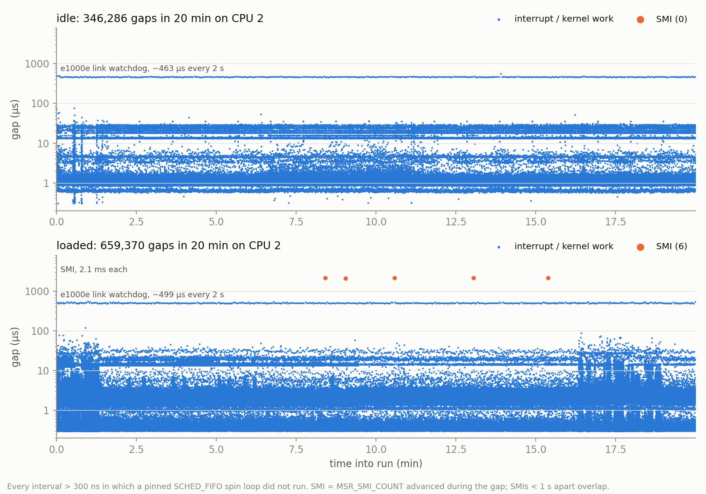

# Platform

Everything here was read from the machine, not typed from memory. Recorded 2026-11-02.

## Hardware

| | |
|---|---|
| Machine | Lenovo ThinkPad T490 |
| CPU | Intel Core i5-8365U (Whiskey Lake), 4 cores / 8 threads, base 1.6 GHz |
| SMT siblings | 0/4, 1/5, 2/6, 3/7 |
| Caches | L1d 32 KiB and L2 256 KiB per core; L3 6 MiB shared |
| Memory | 15 GiB, one NUMA node |
| Storage | NVMe, `/dev/nvme0n1` |
| Network | Wi-Fi only (`iwlwifi`); Ethernet `enp0s31f6` unused |
| Power | AC adapter connected for all runs; battery full |

## Firmware

BIOS **N2IETA6W (1.84)**, dated 2025-07-03. Read as root from `/sys/class/firmware-attributes/thinklmi/attributes/*/current_value`, so every run's sidecar can record it automatically.

| Setting | Value | Why it matters |
|---|---|---|
| SecureBoot | Disable | Unsigned modules (`msr`, harness helpers) load |
| HyperThreadingTechnology | Enable | SMT is controlled at boot with `nosmt` (config 5), not in BIOS |
| SpeedStep | Enable | Frequency is controlled by `intel_pstate` and the governor (config 1) |
| CPUPowerManagement | Enable | C-states are controlled by kernel cmdline (config 2) |
| AdaptiveThermalManagementAC | MaximizePerformance | Fan and thermal policy on AC |
| AdaptiveThermalManagementBattery | Balanced | Not used: runs are on AC |
| VirtualizationTechnology / VTdFeature | Enable / Enable | |
| KernelDMAProtection | Enable | |
| AMTControl | Enable | Intel AMT/ME, a possible SMI source (see below) |
| I8254ClockGating | Auto | |

This firmware has **no C-state or Turbo switch**, unlike some other ThinkPads. Turbo is turned off through `/sys/devices/system/cpu/intel_pstate/no_turbo`, and C-states through `intel_idle.max_cstate`. **Do not change any BIOS setting during the campaign**: doing so invalidates earlier runs.

## OS and kernel

- Debian 13 (trixie), minimal install with no desktop.
- Kernels: stock **`6.12.115+deb13.1-amd64`** and PREEMPT_RT **`6.12.115+deb13.1-rt-amd64`**, same Debian release, so the RT comparison changes only the preemption model. Both images and their header metapackages are held with `apt-mark hold`. 6.12.111 and 6.12.107 remain installed as GRUB fallbacks.
- GRUB: `GRUB_DEFAULT=saved`, with the saved entry set to stock 6.12.115 by name. Debian's menu lists the RT kernel first, so `GRUB_DEFAULT=0` would have booted RT. RT is booted one-shot with `grub-reboot`, so a failed RT boot falls back to stock on the next power cycle.
- Kconfig: `NO_HZ_FULL=y`, `RCU_NOCB_CPU=y`, `PREEMPT_DYNAMIC=y` (voluntary by default), `HZ=250`, **`HWLAT_TRACER` not set**.
- Clocksource `tsc`; CPU flags `constant_tsc` and `nonstop_tsc`.
- Default `intel_pstate` governor is `powersave` with turbo on. `intel_idle` exposes C-states down to C10.

### Speculative-execution mitigations (stock)

Meltdown, MDS and L1TF are **Not affected**, so the kernel runs without KPTI page-table isolation. Active mitigations include Enhanced IBRS (retbleed), a BHI software loop on syscall entry, VERW buffer clearing (mmio_stale_data) and IBPB (vmscape). Expect `mitigations=off` to change syscall cost by less than on a pre-2019 CPU.

## Background services

Disabled with `systemctl disable --now` (reversible with `enable --now`):

| Unit | Reason |
|---|---|
| `avahi-daemon.service` / `.socket` | mDNS broadcasts; SSH uses the IP address |
| `bluetooth.service` | Unused radio |
| `ModemManager.service` | No modem |
| `cron.service`, `anacron.service` / `.timer` | No crontabs on the machine; scheduled wakeups |
| `apt-daily.timer`, `apt-daily-upgrade.timer` | Background package activity; the kernel is held |
| `man-db.timer`, `e2scrub_all.timer`, `fstrim.timer`, `dpkg-db-backup.timer` | Periodic disk and CPU work |

Kept running: `ssh`, `NetworkManager`, `wpa_supplicant` (the only route in), `systemd-journald`, `logind`, `udevd`, `timesyncd`, `dbus`, `polkit`, `bolt`, `getty@tty1`. Kept as timers: `systemd-tmpfiles-clean` and `logrotate`; the run script stops them during measurement.

## Kernel taint

The machine previously hosted a project that loaded out-of-tree modules; that project is finished. The harness still records `/proc/sys/kernel/tainted` in every sidecar and **rejects a run if taint bit 12 (out-of-tree) or 13 (unsigned) is set**, since the flag stays set until reboot.

## Idle baseline and first SMI observation

Taken 2026-11-03 on a fresh boot (stock 6.12.115, taint 0, defaults: `powersave`, turbo on, all C-states), 5 minutes idle, sampled every 10 s:

| Metric | Value |
|---|---|
| Package temperature | mean 36.2 °C, min 34, max 48 |
| Fan | 0 RPM (off) |
| Mean `scaling_cur_freq` across CPUs | 842 MHz |
| Thermal throttle events (core / package) | 0 / 0 |
| `MSR_SMI_COUNT` (0x34) at 22 s after boot | **4,710** |
| SMIs during the 303 s idle window | **2** (about one per 150 s) |

**Almost all SMIs happen during boot.** An earlier reading of 4,813 after 23 h had suggested one SMI every 17 s, but nearly all of those were from boot. The steady-state rate at idle is about two orders of magnitude lower. So the harness must take SMI deltas around each run, never a since-boot count. Phase D measures the rate under load and the duration of each SMI.

## The clock: cTDP-down under the `balanced` profile

The firmware's `balanced` platform profile (ThinkPad DYTC) selects **cTDP level 1: guaranteed
ratio 8, 800 MHz, 10 W** (`CONFIG_TDP_CONTROL` 0x64B = 1, `HWP_CAPABILITIES` guaranteed = 8).
With turbo on, nobody notices, because HWP still reaches 4.1 GHz. With turbo off, the core sits at
800 MHz. `platform_profile=performance` selects nominal: 1.6 GHz guaranteed. Package power limits
(0x610) are the same under both. **Every campaign run holds `platform_profile=performance`.** It is a
runtime setting, so the campaign sets it at boot. Every sidecar records it.

## Phase D: what takes the measured CPU away

`harness/hwgap.c` spins on CPU 2 (`SCHED_FIFO` 90) and records every interval longer than 300 ns
in which it did not run. Each gap also records `MSR_SMI_COUNT`, read on CPU 2 itself, so an SMI is
attributed to the exact gap it caused. Sources were identified by tracing `sched_switch`,
`workqueue_execute_start/end` and `softirq_entry/exit` on CPU 2, plus `/proc/interrupts` deltas.
2026-11-04, stock kernel, defaults (`powersave`, turbo on, all C-states), 20 min per run
(`scripts/phase-d-gaps.sh`, `analysis/gaps.py`, `results/phaseD/stock/`).

| class | source (traced) | idle | loaded¹ |
|---|---|---|---|
| < 5 µs, p50 ~1 µs | local timer interrupt: 250 Hz tick + hrtimers (LOC 257/s) | 255/s | 384/s |
| 5–100 µs, p50 ~14 µs | softirqs at interrupt exit: SCHED (load balance), TIMER, RCU, up to ~25 µs | 34/s | **165/s** |
| ~460–500 µs | **`e1000_watchdog_task`**: the e1000e driver polling the PHY of an **unplugged** Ethernet port, every 2 s (460–483 µs per run, traced idle) | 0.49/s | 0.49/s |
| ~2.1 ms | **SMI** (firmware; invisible to the OS) | 0 in 20 min | **6 in 20 min, 2.11–2.13 ms each** |
| total time lost | | 0.107% | 0.325% |

¹ `stress-ng --cpu 4 --io 2 --vm 2` pinned to CPUs 0,1,4,5. Nothing else ran on CPU 2 or its sibling 6.

Findings:
- **The platform floor is the SMI: 2.1 ms, which no OS setting can prevent.** Every SMI the MSR counted
  was attributed to a gap (6/6 loaded, 1/1 in a `balanced`-profile idle control, where it took 2.5 ms).
  Rate: 0–1 per 20 min idle, 6 per 20 min loaded. The loaded SMIs came at 505–923 s, not during the
  first 500 s at 97–98 °C, so temperature alone does not trigger them. The trigger is unidentified.
  Idle under `balanced` (1) vs `performance` (0) is too few events to tell the profiles apart.
- **The largest OS-side source is a driver for hardware that isn't in use.** The interface is admin-up
  with no carrier (`allow-hotplug enp0s31f6`, DHCP), so the e1000e watchdog runs a ~0.5 ms PHY poll on
  the CPU every 2 s. It's a per-CPU work item, so isolation (`isolcpus`/`nohz_full`) should move it off
  the measured core. The matrix tests that.
- **Load on *other* CPUs triples interference on an idle-looking one.** Softirq-scale gaps went from
  34/s to 165/s, with nothing scheduled on CPU 2 or its sibling.
- **A `SCHED_FIFO` thread does not own its CPU on 6.12.** The fair-server lets CFS kworkers
  (prio 120) preempt it, which is how the e1000e work item gets in.
- **Under load the package reaches 100 °C and throttles constantly** (package throttle count +62,000
  in 20 min), with the profile at `performance`. Thermal partitioning (§3.5) applies to every loaded run.

## Open items

- Cross-check `hwgap` against the kernel hwlat tracer on the RT kernel, which has `HWLAT_TRACER`
  (`scripts/validate-hwgap-hwlat.sh`).
- No disk image taken. The machine is reproducible from this document plus the repo: Debian 13 minimal, the package list in `progress.md`, the services above, and the GRUB setup.
