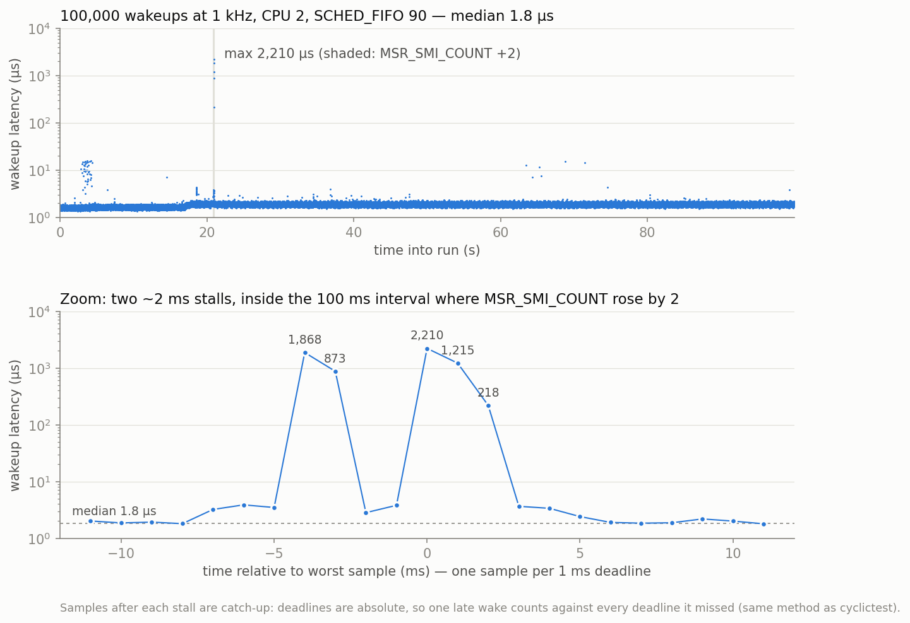

# Validation: `sched_latency` vs `cyclictest`

§3.7: the scheduler-wakeup harness must agree with `cyclictest` on the same
configuration before any of its numbers are trusted.

## Setup

Same for every run on 2026-11-03: kernel `6.12.115+deb13.1-amd64` (stock,
`PREEMPT_DYNAMIC`, cmdline `quiet`), taint 0, governor `powersave`, turbo on,
nothing isolated. Every run measured CPU 2 with `SCHED_FIFO` priority 90,
a 1000 µs interval, 100,000 samples and `mlockall`.

```
harness:     sudo harness/build/sched_latency -c 2 -p 90 -i 1000 -n 100000 -w 1000 -o <dir>
cyclictest:  sudo cyclictest -m -p 90 -a 2 -t 1 -i 1000 -l 100000 -q -h 2000 [--laptop] --histfile=<f>
```

Raw data is in `results/validation/val{1..4}/`. The table comes from `analysis/analyze.py`.

## The variable that matters: `/dev/cpu_dma_latency`

By default `cyclictest` opens `/dev/cpu_dma_latency` and writes 0. This sets a
PM QoS request that keeps every core out of deep C-states for as long as the
file is open. With `--laptop` it skips that step. The harness does not touch it.
The first comparison (val1) therefore compared two different machine states:

| run | tool | QoS target | p50 | p90 | p99 | p99.9 | p99.99 | max (µs) |
|---|---|---|---:|---:|---:|---:|---:|---:|
| val1 | harness | none | 114.9 | 120.8 | 127.4 | 132.9 | 356.6 | 376.8 |
| val1 | cyclictest `--laptop` | none | 109 | 125 | 258 | 267 | 273 | 286 |
| val1 | cyclictest default | **0 µs** | **1** | 2 | 2 | 3 | 214 | 220 |
| val2 | cyclictest `--laptop` | none | 108 | 119 | 252 | 262 | 270 | 295 |
| val2 | harness | none | 122.4 | 227.6 | 244.8 | 254.1 | 264.5 | 282.6 |
| val2 | cyclictest `--laptop` | none | 117 | 256 | 266 | 270 | 284 | 442 |
| val3 | harness | none ¹ | 120.2 | 261.8 | 277.1 | 286.2 | 295.0 | 320.1 |
| val3 | cyclictest default | **0 µs** | 1 | 2 | 2 | 3 | 3 | 2045 |
| val4 | harness | **0 µs** ² | **1.8** | 2.0 | 2.1 | 2.3 | 7.7 | 15.4 |
| val4 | cyclictest `--laptop` | **0 µs** ² | **1** | 2 | 2 | 3 | 3 | 4 |

¹ An external QoS holder was meant to run here, but it failed to start (a shell quoting error), so this run is unheld.
² Both tools ran while a separate process (`/tmp/hold_dma.py`) held the target at 0.

## Result

**Matched state, held at 0 µs (val4):** the two tools agree within 1 µs from
p50 to p99.9. `cyclictest` truncates to whole microseconds, which accounts for
the harness reading ~0.8 µs higher at p50 (1.8 vs 1). Three more held pairs
(`rep1..3`, 20 s apart, each tool's run back to back):

| run | tool | p50 | p90 | p99 | p99.9 | p99.99 | max (µs) | SMIs |
|---|---|---:|---:|---:|---:|---:|---:|---:|
| rep1 | harness | 1.8 | 2.0 | 2.2 | 2.3 | 3.6 | 15.4 | 0 |
| rep2 | harness | 1.8 | 2.0 | 2.2 | 2.7 | 15.0 | **2210.2** | **2** |
| rep3 | harness | 1.9 | 2.1 | 2.2 | 2.3 | 4.0 | 13.3 | 0 |
| rep1 | cyclictest | 1 | 2 | 2 | 3 | 3 | 15 | – |
| rep2 | cyclictest | 1 | 2 | 2 | 3 | 3 | 15 | – |
| rep3 | cyclictest | 1 | 2 | 2 | 3 | 3 | 16 | – |

Percentiles through p99.9 hold within 0.4 µs across all four harness runs.
`cyclictest` reaches the same 15–16 µs max in the repeat runs, so the val4 max gap (15.4 vs 4)
was run-to-run variance, not a harness defect. The rep2 outlier is explained below.

**Matched state, unconstrained:** both tools produce the same two modes, near
~110 µs and ~250 µs. Within a single tool, the share of samples in the upper
mode changes from run to run: the harness p90 was 120.8 in val1 and 227.6 in
val2, and `cyclictest` p90 was 119 and 256 in the val2 pair. The difference
between runs is larger than the difference between tools. At this setting,
then, the tools are consistent: neither is systematically higher.

**Tolerance adopted:** the harness agrees with `cyclictest` within **±1 µs
through p99.9** when the C-state QoS target matches. That is the resolution
`cyclictest` reports at.

## Consequences for the harness

- The QoS target changes p50 by about 60× on this machine. Every sidecar now
  records `cpu_dma_latency_us` (before and after the run), and a run is not
  comparable to another unless they match. The harness itself never sets it.
  C-state policy belongs to the configuration matrix (`cstates` row), not to
  the tool.
- Any comparison with `cyclictest` must say which mode was used. Its default
  numbers describe a machine with deep C-states disabled, not a stock laptop.

## Side observations (for Phase D)

- **SMIs freeze the CPU for ~2 ms.** In rep2, five samples above 20 µs
  (1868, 873, 2210, 1215, 218 µs) all fall inside the single 100 ms
  monitor window in which `MSR_SMI_COUNT` went from 4749 to 4751. Two stalls
  of ~1.9 and ~2.2 ms, each followed by catch-up samples: deadlines are absolute,
  so a wake that is already late counts against every deadline it missed (the same
  as `cyclictest`). These samples are real latency and are kept. They show the
  platform's floor is about 1000× the tuned wakeup latency.

  
  *Generated by `analysis/plot_smi_stall.py results/validation/rep2`.*

- Holding the target at 0 raised package temperature from 52 °C to 62 °C over
  the 100 s run (val4). Unheld runs stayed at 35–39 °C. No throttling and no
  SMIs occurred in any of the four runs.
- The ~110 / ~250 µs modes probably correspond to two idle depths, such as a
  core C-state versus a package C-state exit. This has not been confirmed yet.
  `turbostat` residency during a run would test it.
- val3's `cyclictest` max of 2045 µs is a single sample beyond the
  2000 µs histogram range. It has not been explained yet.

## Still to validate (Phase C)

- [ ] Repeat the val4 pair 3× to get run-to-run spread for the held state.
- [ ] Memory results vs `perf stat` cache/TLB counters (once `memlat` exists).

---

# Validation: `syscall_bench`

## Each mode takes the path it claims to

`perf stat -e raw_syscalls:sys_enter` across one 100k-sample run (1000 warmup iterations) per mode:

| mode | kernel entries | meaning |
|---|---:|---|
| empty | 199 | setup only |
| getppid | 101,199 | 199 + exactly 101,000 (warmup + measured): one entry per call |
| mono | 199 | vDSO, no kernel entry |
| mono_raw | 202 | vDSO, no kernel entry (clocksource is TSC) |

## Frequency ramp: why warmup is time-based

The first version warmed up for 1000 iterations, about 50 µs at this scale. On
the stock `powersave` governor the clock takes tens of ms to ramp, so the results
followed frequency rather than code. `empty` measured 53 ns at ~1.1 GHz and
26 ns at ~2.7 GHz, `mono` measured 42 or 105 ns, and the medians inside a single
`getppid` run fell from 274 to 178 ns as the core sped up. `mono` once read lower
than `empty`, which is impossible if costs add.

Fix: warmup now runs at least 1000 iterations **and** at least 200 ms
(`-W`). This departs from §3.3's iteration-only warmup. It is kept short of 1 s
so that a busy `SCHED_FIFO` loop stays well inside the 950 ms/s RT runtime
limit. Its sidecar records the iterations actually discarded.

## Result: instrumentation overhead

Stock config, `powersave`, turbo on, 2026-11-03. Two interleaved passes of all modes
(`results/validation/syscall/`), with the core at 4.1 GHz by the end of each run:

| mode | p50 | p99 | p99.9 (ns) | p50 − overhead |
|---|---:|---:|---:|---:|
| empty | 14 | 15 | 16 | (this *is* the overhead) |
| mono | 28 | 29 | 29–30 | ~14 |
| mono_raw | 28 | 29 | 29 | ~14 |
| getppid | 105–106 | 159–160 | 164–173 | ~91 |

**Instrumentation overhead is 14 ns** (one timestamp pair at 4.1 GHz).
Within each mode, p50 agreed within 1 ns across passes and run order.
These are turbo numbers. The `governor` config (turbo off) will change all of
them, and the overhead must be re-measured for each configuration, not carried
over.

Caveat: the sidecar's `env_before.cur_khz` is read *before* the warmup, so it
shows the pre-ramp clock. `env_after` is the one that describes the
measurement.

---

# Validation: `ctxswitch`

Pipe ping-pong between two pinned threads, both `SCHED_FIFO` 90. Each sample is one
round trip. Stock config, 2026-11-03, two passes of each placement in interleaved order
(`results/validation/ctxswitch/`). The core was at 4.1 GHz by the end of every run.
No SMIs, and `cpu_dma_latency` was unconstrained.

## The mechanics are what they claim

`perf stat -e context-switches,cpu-migrations` over each whole run:

| placement | rounds (warmup + measured) | expected switches | counted | migrations |
|---|---:|---:|---:|---:|
| same CPU 2↔2 | 181,198 / 176,622 | 2 per round | 362,413 / 353,261 | 2 |
| SMT siblings 2↔6 | 137,271 / 141,698 | 2 per round | 274,562 / 283,414 | 2–3 |
| cross-core 2↔3 | 140,905 / 142,185 | 2 per round | 281,828 / 284,387 | 3 |

That is exactly two switches per round trip in every placement. The migrations happen
at startup (thread B moving from A's CPU to its own), not during measurement.

## Result (round trip, ns; pass 1 / pass 2)

| placement | p50 | p90 | p99 | p99.9 | max |
|---|---:|---:|---:|---:|---:|
| same CPU | 2403 / 2407 | 2501 / 2494 | 2532 / 2526 | 2564 / 2874 | 8752 / 29191 |
| SMT siblings | 4236 / 4221 | 6761 / 6617 | 8380 / 8287 | 8673 / 8502 | 32386 / 34250 |
| cross-core | 4936 / 5002 | 5169 / 5201 | 5551 / 9734 | 23265 / 23895 | 94213 / 70295 |

p50 agrees within 1.5% between passes. One-way, that is ~1.2 µs per same-CPU
switch (including the pipe) and ~2.1–2.5 µs per cross-CPU wakeup.

Observations, not yet explained:
- Cross-CPU round trips show no sign of the ~100 µs deep C-state exit that dominates
  `sched_latency`. Each idle gap is only a few µs, so the idle governor likely picks
  a shallow state. This is untested; idle-state residency (`cpuidle` usage counters) would confirm it.
- SMT siblings have the fastest cross-CPU p50 but a much wider p90–p99 than separate cores.
- Cross-core p99.9 (~23 µs) is 3–9× the other placements' p99.9.
